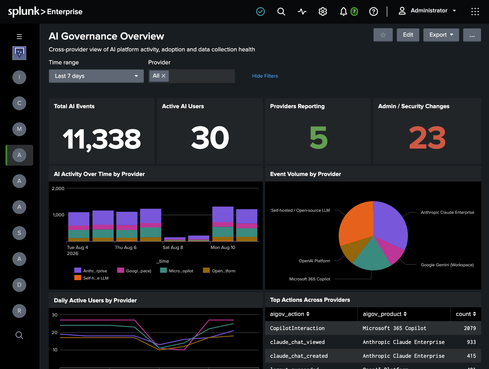
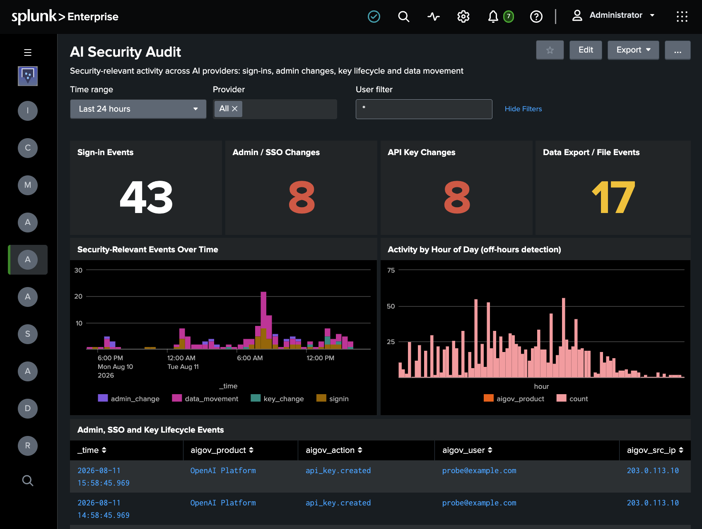
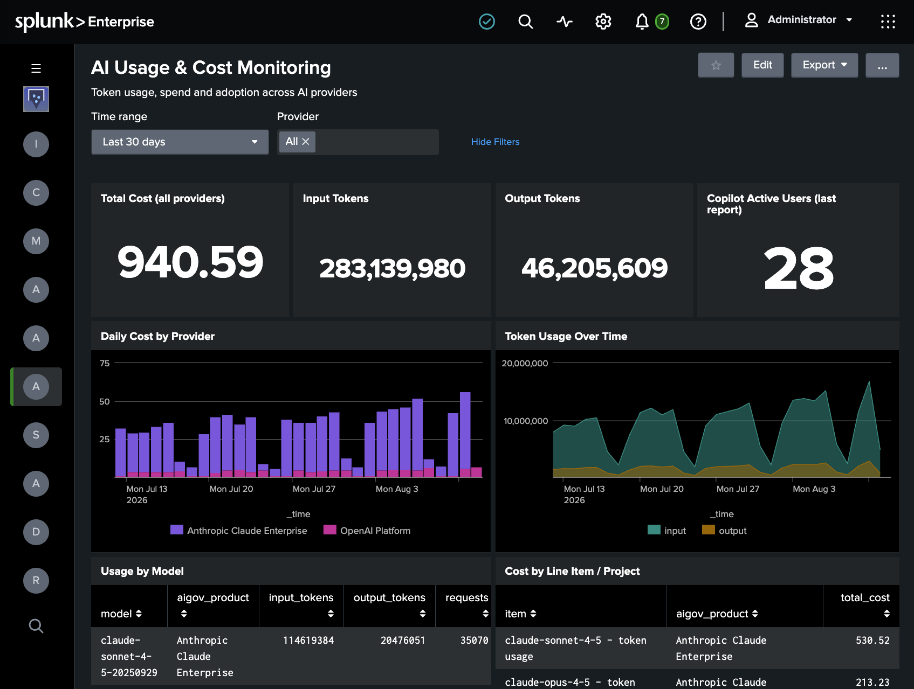
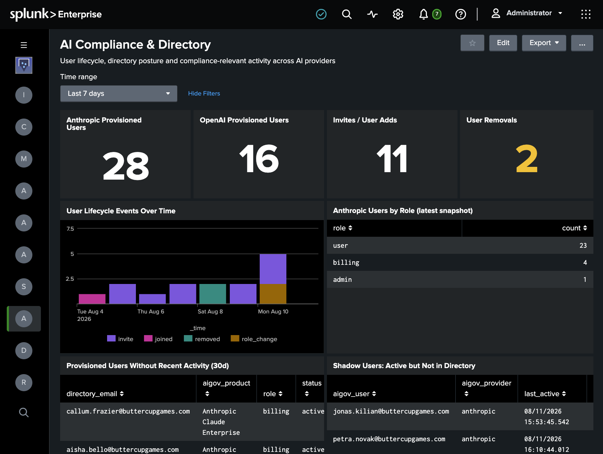

# Enterprise AI Governance App for Splunk

The Enterprise AI Governance App for Splunk provides dashboards and search macros for monitoring Anthropic Claude Enterprise, OpenAI, Google Gemini (Workspace), and Microsoft 365 Copilot. Explore AI platform activity, security events, usage, cost, and directory information through cross-provider views.

The App visualizes data collected by the [Enterprise AI Governance Add-on for Splunk](https://github.com/splunk-platform-apps/enterprise_ai_governance_add-on_for_splunk). The add-on handles provider connections and data collection; this App provides the dashboards and macros used to search that data.

## Features

* **Four dashboards** — AI Governance Overview, AI Security Audit, AI Usage & Cost Monitoring, and AI Compliance & Directory.
* **Search macros** — an index macro, category macros, and cross-provider action macros support the dashboards and your own searches.
* **Cross-provider views** — dashboards use the add-on's normalized `aigov_*` fields to bring supported provider data together.

Dashboard panels display data only for the providers and data domains you have configured through the add-on. Not every provider supplies every data type.

## Getting Started

### Requirements

* A Splunk environment with this App and the [Enterprise AI Governance Add-on for Splunk](https://github.com/splunk-platform-apps/enterprise_ai_governance_add-on_for_splunk) installed.
* Data from at least one supported provider collected by the add-on.
* Permission to search the index containing that data and access the App's dashboards.

### Installation

Install the App using the package provided for your Splunk environment. Install and configure the add-on separately, following its README for provider credentials, inputs, and data collection.

### Configure the data index

The App's dashboards and search macros use `aigov_index` to find AI governance data. Under **Settings → Advanced search → Search macros**, select this App's context and edit `aigov_index` to point to your data index.

For example, if the add-on writes events to an index named `ai_governance`, set the macro definition to:

```text
index=ai_governance
```

If your provider inputs write to different indexes, configure the macro to include all indexes you want the dashboards to search.

### Verify data and open the dashboards

After the add-on has collected data, confirm that events are available. For an index named `ai_governance`, run:

```spl
| tstats count where index=ai_governance by sourcetype
```

You can also verify the App's macros after configuring `aigov_index`:

```spl
`aigov_all` | stats count by aigov_provider, sourcetype
```

Open **AI Governance Overview** from the App's navigation bar, then use the other dashboards to investigate security activity, usage and cost, or directory and compliance data.

## Dashboards

### AI Governance Overview

A starting point for reviewing AI platform activity, adoption, and data availability across providers. Panels include Total AI Events, Active AI Users, Providers Reporting, Admin / Security Changes, AI Activity Over Time by Provider, Event Volume by Provider, Daily Active Users by Provider, Top Actions Across Providers, Most Active Users, and Data Collection Health.



### AI Security Audit

A cross-provider view of security-relevant activity, including sign-ins, administrative and SSO changes, API key events, and data movement. Panels include event counts and trends, activity by hour of day, source IPs associated with multiple users, and event-level detail.



### AI Usage & Cost Monitoring

Usage, spend, and adoption views for providers that supply these data types. Panels include Total Cost, Input Tokens, Output Tokens, Copilot Active Users, Daily Cost by Provider, Token Usage Over Time, Usage by Model, Cost by Line Item / Project, Microsoft 365 Copilot Usage by User, and Anthropic Adoption Summary.



### AI Compliance & Directory

Views of user lifecycle, directory information, and compliance-relevant activity. Panels include provisioned users, user additions and removals, users by role, provisioned users without recent activity, active users not found in available directory data, ChatGPT Enterprise compliance log activity, content-redaction counts, and compliance-relevant events.



## Search Macros

The App includes macros used by its dashboards and available for your own searches:

| Purpose | Macros |
|---|---|
| Data index | `aigov_index` |
| Data categories | `aigov_all`, `aigov_audit`, `aigov_directory`, `aigov_usage`, `aigov_cost`, `aigov_selfhosted` |
| Cross-provider actions | `aigov_signin_actions`, `aigov_admin_actions`, `aigov_key_actions`, `aigov_export_actions` |

For example, to count data-export activity by provider and user:

```spl
`aigov_audit` `aigov_export_actions`
| stats count by aigov_provider, aigov_user
```

The `aigov_selfhosted` macro is included with the App's search macros, but the dashboards documented here focus on Anthropic Claude Enterprise, OpenAI, Google Gemini (Workspace), and Microsoft 365 Copilot.

## Troubleshooting

| Symptom | Check |
|---|---|
| All dashboards are empty, but events exist in Splunk | Confirm that `aigov_index` includes the index receiving the add-on's events and that you have permission to search it. |
| One provider is missing | Confirm that its add-on inputs are enabled and writing events to an index included in `aigov_index`. |
| A usage, cost, or directory panel is empty | Confirm that collection is configured for that data domain. Provider coverage differs by panel. |
| Data appears in searches but not in an expected panel | Check the panel's time range and whether the events contain the fields used by that panel. |
| No provider data is arriving | Use the add-on README for input, credential, and collection troubleshooting. |

## Contributing

See [CONTRIBUTING.md](https://github.com/splunk-platform-apps/.github/blob/main/.github/CONTRIBUTING.md) for details.