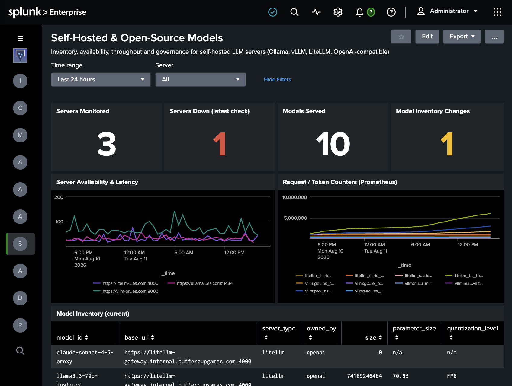

# Enterprise AI Governance App for Splunk

The Enterprise AI Governance App for Splunk provides dashboards, alerts, and search macros for monitoring Anthropic Claude Enterprise, OpenAI, Google Gemini (Workspace), Microsoft 365 Copilot, and self-hosted LLM servers. Explore AI platform activity, security events, usage, cost, directory information, and self-hosted model availability through cross-provider views.

The App visualizes data collected by the [Enterprise AI Governance Add-on for Splunk](https://github.com/splunk-platform-apps/enterprise_ai_governance_add-on_for_splunk). The add-on handles provider connections and data collection; this App provides the dashboards, alerts, and macros used to search that data.

## Features

* **Five dashboards** — AI Governance Overview, AI Security Audit, AI Usage & Cost Monitoring, Self-Hosted & Open-Source Models, and AI Compliance & Directory.
* **Eight alerts** — cover security changes, data exports, user activity, spend thresholds, and self-hosted model and server changes. All alerts ship disabled.
* **Eleven search macros** — an index macro, category macros, and cross-provider action macros support the dashboards, alerts, and your own searches.
* **Cross-provider views** — dashboards and alerts use the add-on's normalized `aigov_*` fields to search supported provider data.

Dashboard panels and alerts can use only the providers and data domains you have configured through the add-on. Not every provider supplies every data type.

## Getting Started

### Requirements

* A Splunk environment with this App and the [Enterprise AI Governance Add-on for Splunk](https://github.com/splunk-platform-apps/enterprise_ai_governance_add-on_for_splunk) installed.
* Data from at least one supported provider collected by the add-on.
* Permission to search the index containing that data and access the App's dashboards. To configure alerts, you also need permission to manage the App's saved searches.

### Installation

Install the App using the package provided for your Splunk environment. Install and configure the add-on separately, following its README for provider credentials, inputs, and data collection.

### Configure the data index

The App's dashboards, alerts, and search macros use `aigov_index` to find AI governance data. Under **Settings → Advanced search → Search macros**, select this App's context and edit `aigov_index` to point to your data index.

For example, if the add-on writes events to an index named `ai_governance`, set the macro definition to:

```text
index=ai_governance
```

If your provider inputs write to different indexes, configure the macro to include all indexes you want the dashboards and alerts to search.

### Verify data and open the dashboards

After the add-on has collected data, confirm that events are available. For an index named `ai_governance`, run:

```spl
| tstats count where index=ai_governance by sourcetype
```

You can also verify the App's macros after configuring `aigov_index`:

```spl
`aigov_all` | stats count by aigov_provider, sourcetype
```

Open **AI Governance Overview** from the App's navigation bar, then use the other dashboards to investigate security activity, usage and cost, self-hosted models, or directory and compliance data.

### Review and enable alerts

Under **Settings → Searches, reports, and alerts**, select this App's context and review the bundled alerts. All eight ship **disabled**. Before enabling an alert, confirm that its required data is being collected, review its search and schedule, and tune its thresholds and notification settings for your organization.

## Dashboards

### AI Governance Overview

A starting point for reviewing AI platform activity, adoption, and data availability across providers. Panels include Total AI Events, Active AI Users, Providers Reporting, Admin / Security Changes, AI Activity Over Time by Provider, Event Volume by Provider, Daily Active Users by Provider, Top Actions Across Providers, Most Active Users, and Data Collection Health.


### AI Security Audit

A cross-provider view of security-relevant activity, including sign-ins, administrative and SSO changes, API key events, and data movement. Panels include event counts and trends, activity by hour of day, source IPs associated with multiple users, and event-level detail.


### AI Usage & Cost Monitoring

Usage, spend, and adoption views for providers that supply these data types. Panels include Total Cost, Input Tokens, Output Tokens, Copilot Active Users, Daily Cost by Provider, Token Usage Over Time, Usage by Model, Cost by Line Item / Project, Microsoft 365 Copilot Usage by User, and Anthropic Adoption Summary.


### Self-Hosted & Open-Source Models

Inventory and operational views for monitored self-hosted LLM servers. Panels include Servers Monitored, Servers Down, Models Served, Model Inventory Changes, Server Availability & Latency, Request / Token Counters, Model Inventory, Model Inventory Change Audit, and Currently Loaded Models.



### AI Compliance & Directory

Views of user lifecycle, directory information, and compliance-relevant activity. Panels include provisioned users, user additions and removals, users by role, provisioned users without recent activity, active users not found in available directory data, ChatGPT Enterprise compliance log activity, content-redaction counts, and compliance-relevant events.


## Alerts

All eight alerts ship disabled. Enable and tune the ones relevant to your organization under **Settings → Searches, reports, and alerts** (app context `TA-ai-governance`).

| Alert | Fires when | Schedule |
|---|---|---|
| AI Governance - API Key Created or Deleted | An API key or service account is created, updated or deleted in a monitored AI platform | Every 30 min |
| AI Governance - Admin or SSO Configuration Change | An administrative, role, SSO or domain configuration change is detected | Every 30 min |
| AI Governance - Data Export Activity | A data export, file download or bulk data movement is detected | Every 30 min |
| AI Governance - New AI User Seen | A user is observed on a monitored AI platform for the first time in the last day | Daily, 06:00 |
| AI Governance - Off-Hours Activity Spike | More than 100 events per hour occur between midnight and 6 AM (tune the threshold and hours for your timezone) | Daily, 07:00 |
| AI Governance - Daily Spend Threshold Exceeded | Daily spend for a provider exceeds the configured threshold (default 1000) | Daily, 08:00 |
| AI Governance - New Self-Hosted Model Detected | A model is added to or removed from a monitored self-hosted LLM server | Every 30 min |
| AI Governance - Self-Hosted Server Down | A monitored self-hosted LLM server fails its health check | Every 15 min |

## Search Macros

The App includes macros used by its dashboards and alerts. They are also available for your own searches:

| Purpose | Macros |
|---|---|
| Data index | `aigov_index` |
| Data categories | `aigov_all`, `aigov_audit`, `aigov_directory`, `aigov_usage`, `aigov_cost`, `aigov_selfhosted` |
| Cross-provider actions | `aigov_signin_actions`, `aigov_admin_actions`, `aigov_key_actions`, `aigov_export_actions` |

For example, to count data-export activity by provider and user:

```spl
`aigov_audit` `aigov_export_actions`
| stats count by aigov_provider, aigov_user
```

The App also includes five event types and CIM-style tags (`authentication`, `change`, `account`, and `audit`) for search and correlation.

## Troubleshooting

| Symptom | Check |
|---|---|
| All dashboards are empty, but events exist in Splunk | Confirm that `aigov_index` includes the index receiving the add-on's events and that you have permission to search it. |
| One provider is missing | Confirm that its add-on inputs are enabled and writing events to an index included in `aigov_index`. |
| A usage, cost, directory, or self-hosted panel is empty | Confirm that collection is configured for that data domain. Provider coverage differs by panel. |
| Data appears in searches but not in an expected panel | Check the panel's time range and whether the events contain the fields used by that panel. |
| An alert does not run | Confirm that it is enabled, its schedule is configured, and the search has permission to access the data index. |
| An alert runs but produces no results | Run its search manually in the App's context. Check `aigov_index`, the required data domain, the search time range, and any threshold conditions. |
| No provider data is arriving | Use the add-on README for input, credential, and collection troubleshooting. |

## Contributing

See [CONTRIBUTING.md](https://github.com/splunk-platform-apps/.github/blob/main/.github/CONTRIBUTING.md) for details.