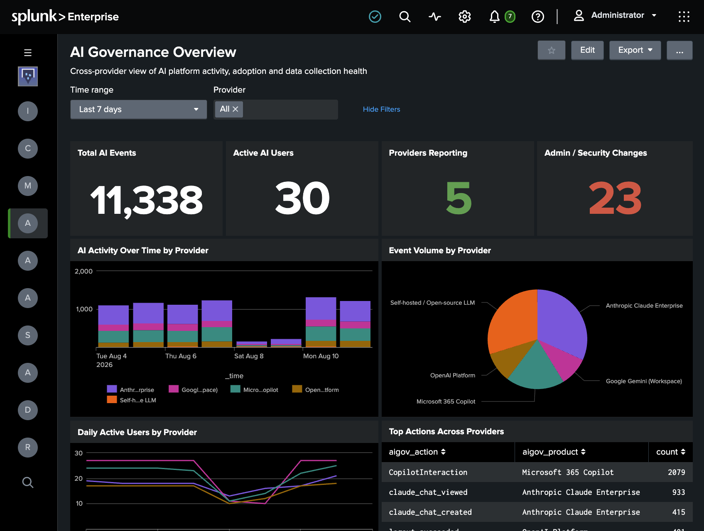
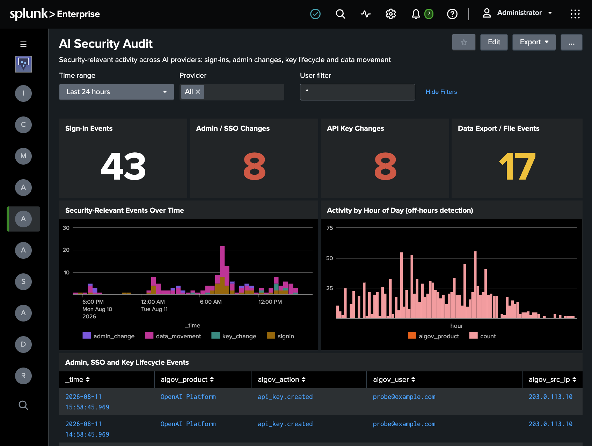
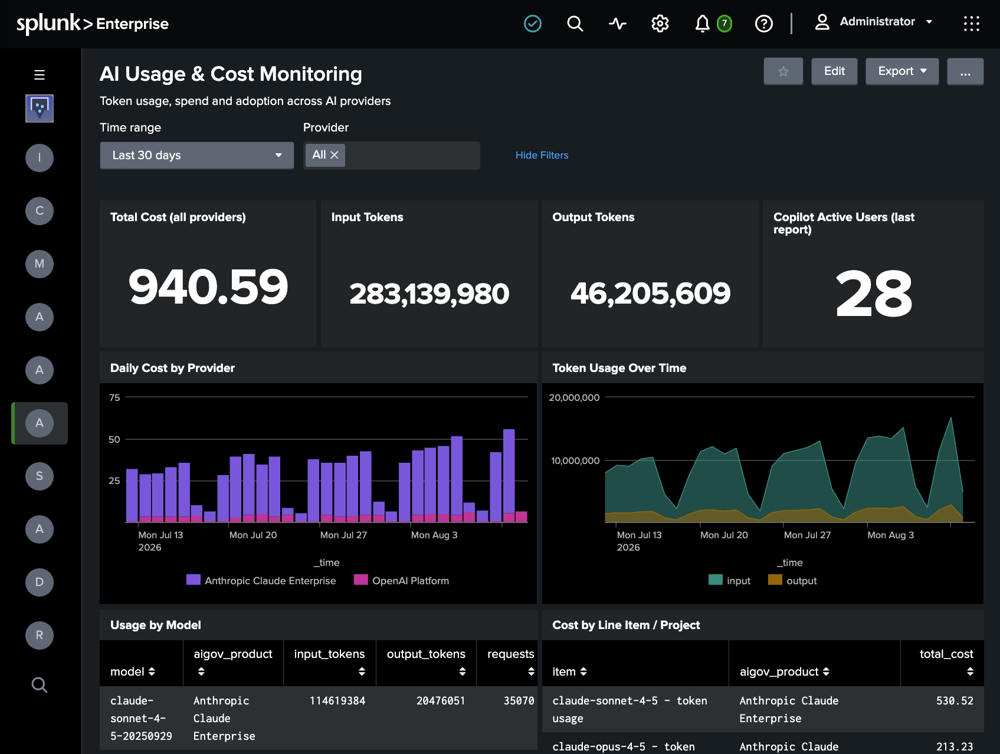
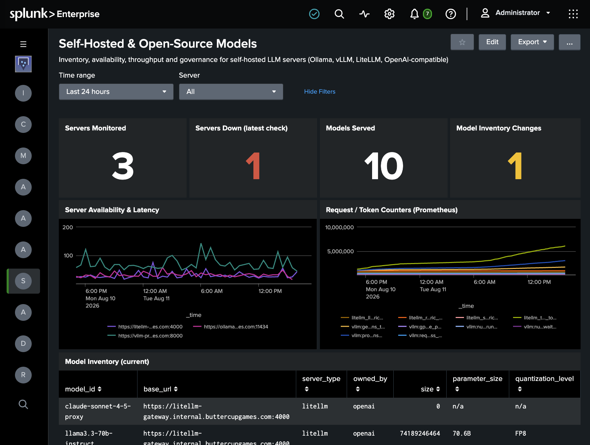
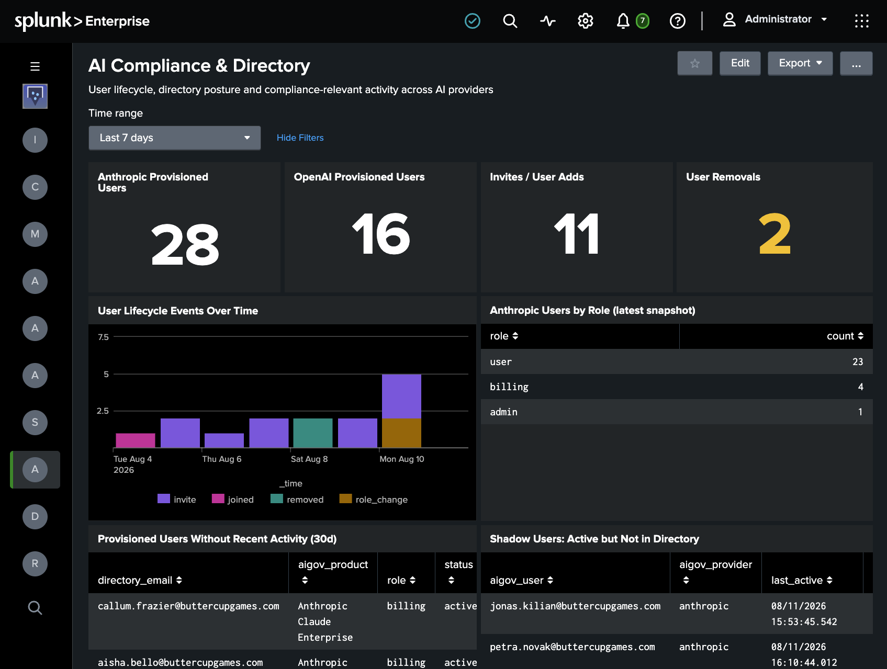

# Enterprise AI Governance App for Splunk

The Enterprise AI Governance App for Splunk provides dashboards, alerts, and search macros for monitoring Anthropic Claude Enterprise, OpenAI, Google Gemini (Workspace), Microsoft 365 Copilot, and self-hosted LLM servers. Explore AI platform activity, security events, usage, cost, directory information, and self-hosted model availability through cross-provider views.

> [!IMPORTANT]
> The app visualizes data collected by the [Enterprise AI Governance Add-on for Splunk](https://github.com/splunk-platform-apps/enterprise_ai_governance_add-on_for_splunk). The add-on handles provider connections and data collection; this app provides the dashboards, alerts, and macros used to search that data.

## Features

- Set of **five dashboards** providing views across supported AI platforms:
  | Dashboard | Content Details |
  |---|---|
  | **AI Governance Overview** (default) | Review activity, adoption, and data availability across providers. |
  | **AI Security Audit** | Investigate sign-ins, administrative changes, API key events, and data movement. |
  | **AI Usage & Cost Monitoring** | Explore token usage, spend, and adoption where providers supply that data. |
  | **Self-Hosted & Open-Source Models** | Monitor server availability, model inventory, and runtime metrics. |
  | **AI Compliance & Directory** | Review user lifecycle, directory data, and compliance-relevant activity. |

- **Eight alerts** covering API key changes, admin or SSO configuration changes, data exports, new AI users, off-hours activity spikes, daily spend thresholds, new self-hosted models, and self-hosted servers going down. [Available alerts](#alerts).

- **Eleven search macros** support the dashboards, alerts, and your own searches.
  | Purpose | Macros |
  |---|---|
  | Data index | `aigov_index` |
  | Data categories | `aigov_all`, `aigov_audit`, `aigov_directory`, `aigov_usage`, `aigov_cost`, `aigov_selfhosted` |
  | Cross-provider actions | `aigov_signin_actions`, `aigov_admin_actions`, `aigov_key_actions`, `aigov_export_actions` |

- **Cross-provider views** — dashboards and alerts use the add-on normalized `aigov_*` fields to search supported provider data.

👉 Dashboard panels and alerts can use only the providers and data domains you have configured through the add-on. **Not every provider supplies every data type.**

## Getting Started

### Requirements

- **Splunk** Enterprise or Splunk Cloud Platform 9.x/10.x,
- **Enterprise AI Governance Add-on for Splunk**:
   - The Enterprise AI Governance App for Splunk expects data to be retrieved from at least one supported provider using the **Enterprise AI Governance Add-on for Splunk**.
   - Ensure such add-on is installed and configured to collect the required data as per [documentation](https://splunk-platform-apps.github.io/enterprise_ai_governance_add-on_for_splunk/).
- Permission to search the index containing that data and access the app dashboards.
- (To configure alerts) Permission to manage the app saved searches.

### Installation

Download the [latest release](https://github.com/splunk-platform-apps/enterprise_ai_governance_app_for_splunk/releases) package and install it via
**Apps → Manage Apps → Install app from file** (Splunk Enterprise), the self-service app install flow (Splunk Cloud), or [ACS](https://docs.splunk.com/Documentation/SplunkCloud/latest/Config/ManageApps).

Where to install:

| Tier | Install? | Why |
|---|---|---|
| Search head | Yes | Dashboards, macros, props (search-time), saved searches |
| Heavy forwarder / IDM | No | Not applicable (data collection is handled by the add-on) |
| Indexers | No | Not applicable |
| Universal forwarder | No | Not applicable |

### Configuration

Splunk Admins are requested to:
- Create a dedicated index on the Search head to collect your events, if not done yet (e.g. `ai_governance`).
  - **Scope the search macro in the Search Head** — Update the `aigov_index` macro to point to the appropriate index where the data is stored. This can be done via **Settings → Advanced search → Search macros**. Every dashboard and saved search reads through this macro.

👉 If your provider inputs write to different indexes, configure the macro to include all indexes you want the dashboards and alerts to search.

#### Alerts

All alerts ship **disabled**.

Before enabling an alert, confirm that its required data is being collected, review its search and schedule, and tune its thresholds and notification settings for your organization under **Settings → Searches, reports, and alerts**, select this app context (`TA-ai-governance`) and review the bundled alerts. 

| Alert | Fires when | Schedule |
|---|---|---|
| AI Governance - API Key Created or Deleted | An API key or service account is created, updated or deleted in a monitored AI platform | Every 30 min |
| AI Governance - Admin or SSO Configuration Change | An administrative, role, SSO or domain configuration change is detected | Every 30 min |
| AI Governance - Data Export Activity | A data export, file download or bulk data movement is detected | Every 30 min |
| AI Governance - New AI User Seen | A user is observed on a monitored AI platform for the first time in the last day | Daily, 06:00 |
| AI Governance - Off-Hours Activity Spike | More than 100 events per hour occur between midnight and 6 AM (tune the threshold and hours for your timezone) | Daily, 07:00 |
| AI Governance - Daily Spend Threshold Exceeded | Daily spend for a provider exceeds the configured threshold (default 1000) | Daily, 08:00 |
| AI Governance - New Self-Hosted Model Detected | A model is added to or removed from a monitored self-hosted LLM server | Every 30 min |
| AI Governance - Self-Hosted Server Down | A monitored self-hosted LLM server fails its health check | Every 15 min |

### Usage

Open the app to visualize data on the following dashboards:

- **AI Governance Overview** — A starting point for reviewing AI platform activity, adoption, and data availability across providers. Panels include Total AI Events, Active AI Users, Providers Reporting, Admin / Security Changes, AI Activity Over Time by Provider, Event Volume by Provider, Daily Active Users by Provider, Top Actions Across Providers, Most Active Users, and Data Collection Health.

  
- **AI Security Audit** — A cross-provider view of security-relevant activity, including sign-ins, administrative and SSO changes, API key events, and data movement. Panels include event counts and trends, activity by hour of day, source IPs associated with multiple users, and event-level detail.

  
- **AI Usage & Cost Monitoring** — Usage, spend, and adoption views for providers that supply these data types. Panels include Total Cost, Input Tokens, Output Tokens, Copilot Active Users, Daily Cost by Provider, Token Usage Over Time, Usage by Model, Cost by Line Item / Project, Microsoft 365 Copilot Usage by User, and Anthropic Adoption Summary.

  
- **Self-Hosted & Open-Source Models** - Inventory and operational views for monitored self-hosted LLM servers. Panels include Servers Monitored, Servers Down, Models Served, Model Inventory Changes, Server Availability & Latency, Request / Token Counters, Model Inventory, Model Inventory Change Audit, and Currently Loaded Models.

  
- **AI Compliance & Directory** -  Views of user lifecycle, directory information, and compliance-relevant activity. Panels include provisioned users, user additions and removals, users by role, provisioned users without recent activity, active users not found in available directory data, ChatGPT Enterprise compliance log activity, content-redaction counts, and compliance-relevant events.
  
  


## Troubleshooting

| Symptom | Check |
|---|---|
| All dashboards are empty, but events exist in Splunk | Confirm that `aigov_index` includes the index receiving the add-on events and that you have permission to search it. |
| One provider is missing | Confirm that its add-on inputs are enabled and writing events to an index included in `aigov_index`. |
| A usage, cost, directory, or self-hosted panel is empty | Confirm that collection is configured for that data domain. Provider coverage differs by panel. |
| Data appears in searches but not in an expected panel | Check the panel time range and whether the events contain the fields used by that panel. |
| An alert does not run | Confirm that it is enabled, its schedule is configured, and the search has permission to access the data index. |
| An alert runs but produces no results | Run its search manually in the app context. Check `aigov_index`, the required data domain, the search time range, and any threshold conditions. |

### SPL Examples

```spl
<!-- Count events in index per sourcetype -->
| tstats count where index=ai_governance by sourcetype
<!-- Verify app macros -->
`aigov_all` | stats count by aigov_provider, sourcetype
<!-- Count data-export activity by provider and user -->
`aigov_audit` `aigov_export_actions` | stats count by aigov_provider, aigov_user
```

## Versions Supported

Tested against Splunk Enterprise XX.

## Versions Supported

* Splunk Cloud Platform.
* Splunk Enterprise 9.3 and 10.x (developed and tested on Splunk Enterprise 10.4, standalone).

## Contributing

See [CONTRIBUTING.md](https://github.com/splunk-platform-apps/.github/blob/main/.github/CONTRIBUTING.md) for details.
